  <picture>
    <source media="(max-width: 768px)" srcset="assets/hero-mobile.svg" />
    
  </picture>

  <a href="https://utsavdoye.com">utsavdoye.com</a>
  &nbsp;·&nbsp;
  <a href="https://www.linkedin.com/in/utsav-doye/">LinkedIn</a>
  &nbsp;·&nbsp;
  <a href="mailto:utsavdoye07@gmail.com">utsavdoye07@gmail.com</a>

 

  
  

  
  

  Only the first window is written by hand. Everything under it is rebuilt every night from my GitHub activity by <a href=".github/workflows/profile.yml">one workflow</a>.

